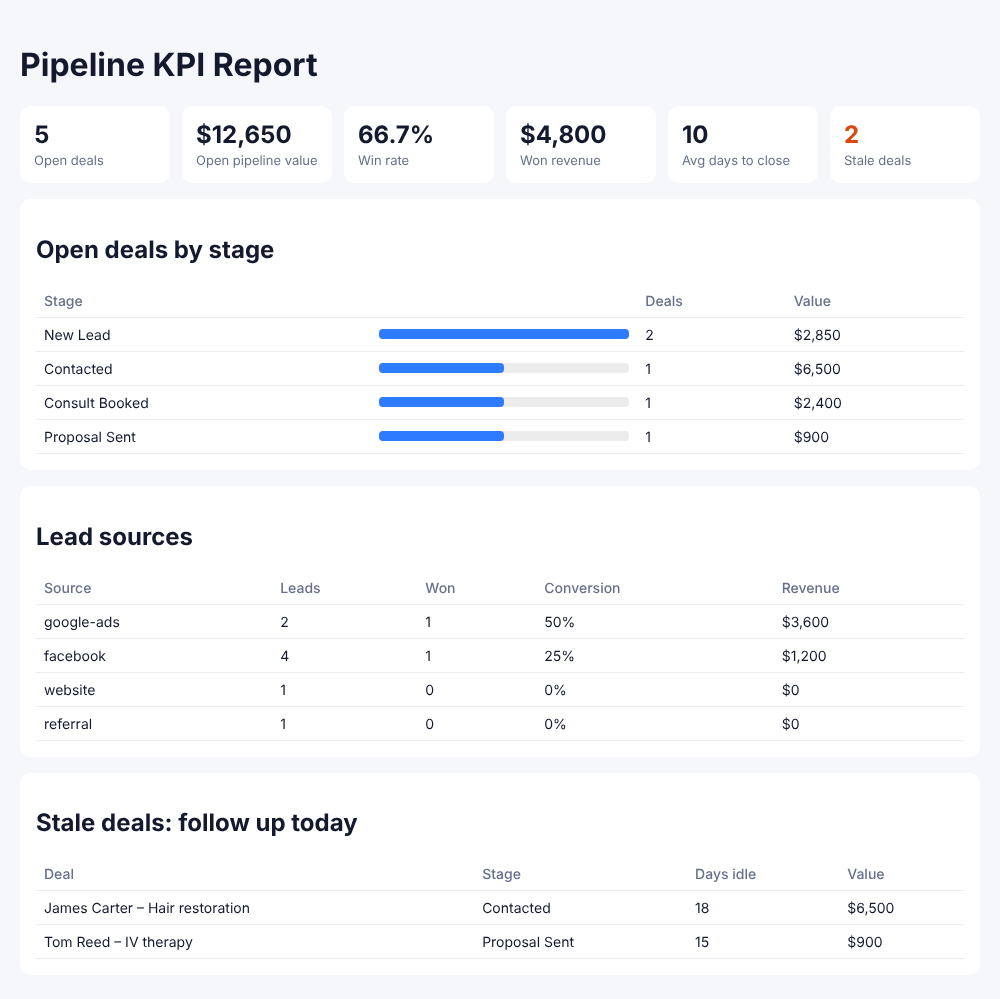

# GoHighLevel CRM Automation Kit

**Call every new lead within 5 minutes, and see exactly where deals are stalling.** This kit plugs into a GoHighLevel sub-account and does two jobs that most GHL setups get wrong:

1. **Speed-to-lead routing.** Every lead from Facebook, Google Ads, your website or a referral is tagged by source and service, dropped into the right pipeline stage, and gets a "Call this lead" task due in 5 minutes (2 minutes for high-value leads).
2. **Pipeline KPI dashboard.** One command produces a report with open pipeline value, win rate, average days to close, revenue by lead source, and a **stale deals** list of opportunities nobody has touched in 7+ days.

Built by [ThinkAIWorks](https://thinkaiworks.com).



## Quick start

```bash
cp .env.example .env
npm run report:sample   # builds reports/kpi-report.html from sample data, no GHL account needed
npm test
```

Go live:

1. In your GHL sub-account create a **Private Integration** token (scopes: contacts, opportunities).
2. Fill in `GHL_TOKEN`, `GHL_LOCATION_ID`, `GHL_PIPELINE_ID`, `GHL_NEW_LEAD_STAGE_ID`.
3. Run with `DRY_RUN=1` first. Every API call is logged, nothing is written.
4. Set `DRY_RUN=0` and `npm start`.
5. Point your lead sources at `POST /webhook/lead` with the header `x-webhook-secret`.

## What happens to each lead

```
Webhook  →  normalise (name / email / phone / source / service / value)
         →  tags: new-lead, source:facebook, service:botox, high-value
         →  upsert contact (no duplicates)
         →  opportunity in "New Lead" stage
         →  task "Call new lead: Maria Lopez" due in 5 min (2 min if high-value)
```

Accepts GoHighLevel workflow webhooks, website form posts, or Facebook Lead Ads forwarded by n8n / Make.

## KPI report

```bash
npm run report          # live data from GHL
npm run report:sample   # sample clinic data
```

| Metric | Why it matters |
|---|---|
| Open pipeline value | Revenue you can still win this month |
| Win rate | Are leads being worked properly? |
| Avg days to close | How long cash takes to land |
| Revenue by source | Which ad channel actually pays |
| Stale deals | The follow-up list for today |

Schedule it daily with cron, n8n or a GHL workflow and email the HTML to the owner.

## Safety

- `DRY_RUN=1` mode for testing on client accounts.
- Shared-secret check with timing-safe comparison.
- Automatic retry on GHL rate limits (HTTP 429).
- No dependencies to audit: plain Node.js 22.

## Stack

Node.js · GoHighLevel API v2 · Webhooks · works alongside n8n / Make
